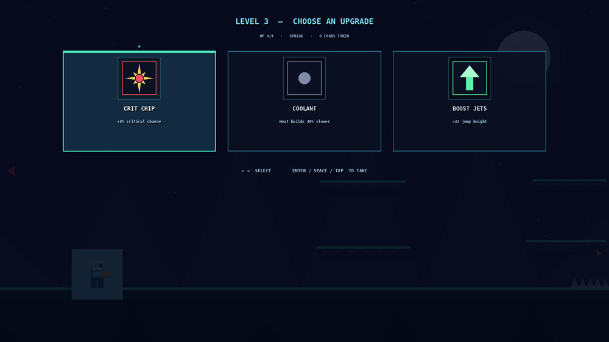
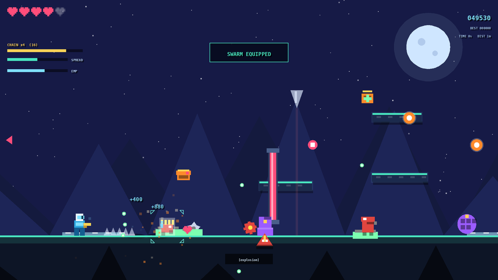
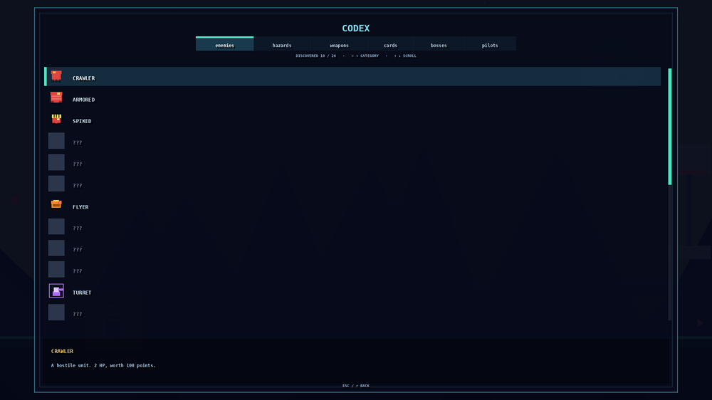
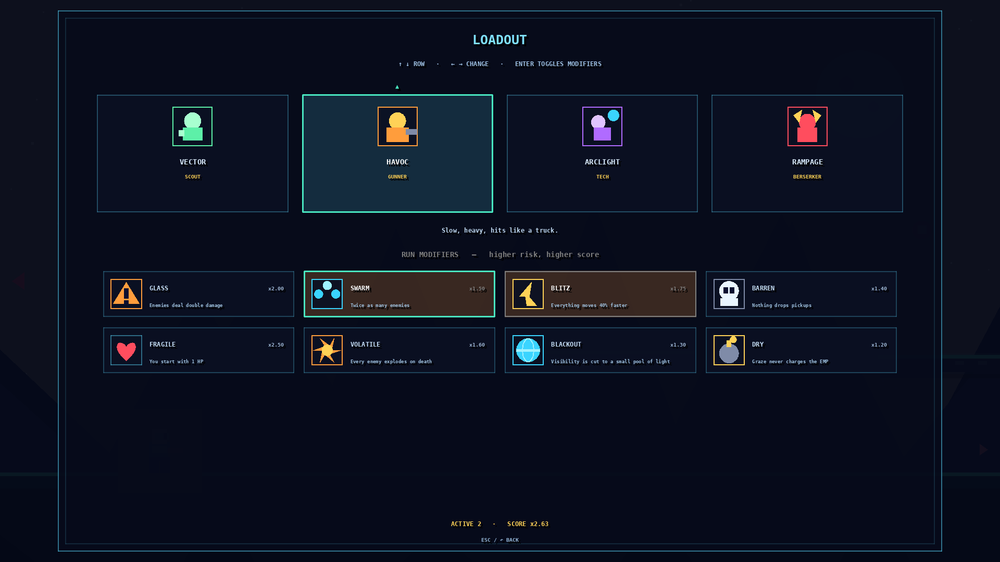
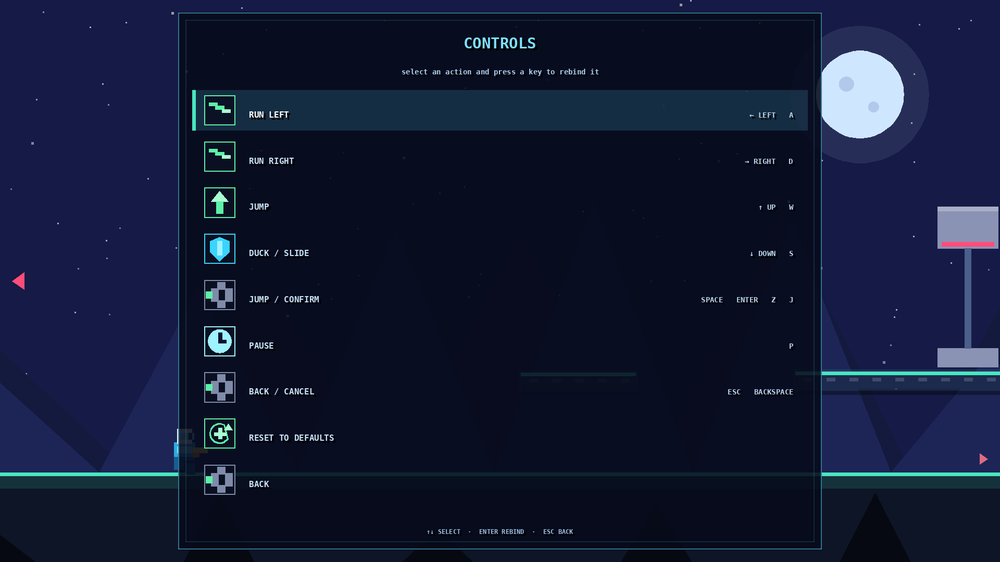

<div align="center">

# NEON RUNNER

**A retro auto-fire side-scrolling shooter — one self-contained HTML file. No install, works offline, MIT licensed.**

[](https://github.com/drsamonline/neon-runner/stargazers)
[](https://github.com/drsamonline/neon-runner/network/members)
[](LICENSE)
[](https://github.com/drsamonline/neon-runner/commits/main)

### ▶&nbsp; <a href="https://drsamonline.github.io/neon-runner/play/"><b>PLAY NOW</b></a> &nbsp;·&nbsp; <a href="https://drsamonline.github.io/neon-runner/">Landing page</a>

<sub>**Landing page:** <https://drsamonline.github.io/neon-runner/> &nbsp;|&nbsp; **Play the game:** <https://drsamonline.github.io/neon-runner/play/></sub>

</div>

---

<div align="center">


**A retro auto-fire side-scrolling shooter. You never press fire — your gun shoots anything in range.**

Move, jump, duck. That is the entire control scheme.

<br>

### ▶&nbsp; <a href="https://drsamonline.github.io/neon-runner/play/"><b>PLAY IT NOW</b></a>

<sub>**<https://drsamonline.github.io/neon-runner/play/>**</sub>

[](https://drsamonline.github.io/neon-runner/play/)
[](https://drsamonline.github.io/neon-runner/play/)

<sub>Runs in the browser · nothing to install · works offline once loaded</sub>

<br>

[](https://github.com/drsamonline/neon-runner/actions/workflows/ci.yml)
[](https://drsamonline.github.io/neon-runner/)
[](LICENSE)
[](#-changelog)
[](https://github.com/drsamonline/neon-runner/commits/main)

[](#-zero-dependencies)
[](#-zero-dependencies)
[](#-quick-start)
[](#-quick-start)
[](#-quick-start)
[](#-how-it-works)
[](#-testing)
[](#-contributing)



</div>

---

## ▶ Play it

<table>
<tr>
<td width="50%" valign="top">

### 🌐 Play online

**[drsamonline.github.io/neon-runner](https://drsamonline.github.io/neon-runner/play/)**

Nothing to install. Opens in any modern browser — desktop or phone. Once loaded it runs entirely offline.

</td>
<td width="50%" valign="top">

### 💾 Run it locally

**[Download `index.html`](https://github.com/drsamonline/neon-runner/raw/main/index.html)** — or clone the repo:

```bash
git clone https://github.com/drsamonline/neon-runner.git
cd neon-runner
open index.html    # macOS
                   # xdg-open on Linux, start on Windows
```

</td>
</tr>
</table>

**No install. No build. No server. One file.** Open `index.html` in any modern browser — double-click it, or drag it into a tab. That is the whole setup.

Works identically from `file://` and from a web server. Works offline. Works on a phone.

| | |
| :-- | :-- |
| **Live** | [drsamonline.github.io/neon-runner](https://drsamonline.github.io/neon-runner/play/) |
| **Source** | [github.com/drsamonline/neon-runner](https://github.com/drsamonline/neon-runner) |
| **Download** | [index.html](https://github.com/drsamonline/neon-runner/raw/main/index.html) (176 KB, self-contained) |
| **Build status** | [](https://github.com/drsamonline/neon-runner/actions/workflows/ci.yml) |

---

## 📸 Screenshots

<div align="center">

**In play** — auto-fire lock, chain meter, mode objective, live threats



<br><br>

**Codex** — 95 entries with discovery tracking



<br><br>

**Loadout** — pilots and stacking run modifiers



<br><br>

**Controls** — every binding, live, rebindable



</div>


---

## Contents

- [Play it](#-play-it) — **[live demo](https://drsamonline.github.io/neon-runner/play/)**
- [Screenshots](#-screenshots)
- [Why it is interesting](#-why-it-is-interesting)
- [Controls](#-controls)
- [The duck rule](#-the-duck-rule)
- [Systems](#-systems)
- [Content](#-content)
- [Game modes](#-game-modes)
- [Accessibility](#-accessibility)
- [Quick start](#-quick-start)
- [Project layout](#-project-layout)
- [How it works](#-how-it-works)
- [Testing](#-testing)
- [Balance](#-balance)
- [Zero dependencies](#-zero-dependencies)
- [Changelog](#-changelog)
- [Credits](#-credits)
- [Contributing](#-contributing)
- [License](#-license)

---

## ✨ Why it is interesting

Most shooters ask you to aim. This one asks you to **position**.

The gun is fully automatic and picks its own targets, so the only decisions left are spatial ones: how close do you dare stand, when do you break line of sight, when do you spend your slide, when do you jump and when do you duck. Every mechanic below exists to make those decisions interesting rather than to add buttons.

- **Three controls.** Left, right, jump, duck. That is it. There is no fire button, and there never will be.
- **Range is a resource.** Your gun only fires when something is inside its circle, so damage output is a function of positioning.
- **Heat punishes camping.** Firing builds heat, and heat only cools when *nothing is in range*. Standing still and spraying is impossible — you have to weave.
- **The chain rewards aggression.** Kills within 2.5s stack up to ×8. Staying close is how you score; it is also how you die.
- **Graze rewards nerve.** Enemy fire that passes close but does not hit charges an EMP. Getting shot at is progress.

---

## 🎮 Controls

| Action | Keyboard | Touch | Gamepad |
| :-- | :-- | :-- | :-- |
| Run left / right | `←` `→` or `A` `D` | ◀ ▶ | D-pad / left stick |
| Jump | `↑`, `W` or `Space` | ▲ | A / B |
| Duck | `↓` or `S` | ▼ | D-pad down |
| Slide | hold `↓` while running | hold ▼ while running | down + direction |
| Pause | `P` | ⏸ | Start |
| Back / close menu | `Esc` or `⌫` | ↩ | — |
| Mute | `M` | — | — |

Every binding is remappable from **CONTROLS** on the title screen (or the pause menu). The boot screen shows your current keys, so you can see what to press before you start.

Touch button size and opacity are adjustable, and there is a left-handed pad layout.

**Audio note.** Browsers refuse to start audio until the page has received a real user gesture — this is a hard browser rule, not a bug. The game unlocks its audio on the *first keypress or click*, and the boot screen says so explicitly while it is waiting. If you ever hear nothing, press any key or click once.

---

## 🦆 The duck rule

Ducking is not decorative. It changes your hitbox from 42px tall to 24px tall, and several threats are tuned around exactly that:

- **Turret lasers** fire flat at standing chest height. Duck and they sail over your head.
- **Laser gates** span chest-to-knee. Duck and you walk straight under them.
- **Flyer volleys** aimed at your centre line pass overhead when you crouch.

Jumping and ducking are answers to different problems. Learning which is which is most of the skill.

---

## ⚙️ Systems

| System | What it does |
| :-- | :-- |
| **Auto-fire** | Targets the nearest threat in range, weighted toward exploders and turrets. A reticle shows the current lock. |
| **Overheat** | ~19 shots to overheat. Cools only when nothing is in range. Managing it means breaking line of sight on purpose. |
| **Chain multiplier** | Kills within 2.5s stack ×1 → ×8. |
| **Graze → EMP** | Near-misses charge a meter that auto-fires a screen-clearing blast. |
| **Slide** | Hold duck while running for a burst of speed with brief invulnerability. |
| **Stomp** | Landing on an enemy kills it and bounces you. Spiked enemies punish this. |
| **Weapon rarity** | Every weapon drop rolls COMMON → LEGENDARY, scaling damage ×1.0 → ×2.8. |
| **Companions** | Drones orbit and fire, turrets deploy on the ground, orbs damage on contact. |
| **Roguelite cards** | Every 5 kills, pick 1 of 3 upgrades. 40 cards across three rarity tiers. |
| **Doom wall** | A red wall advances from behind. It never stops, and it rubber-bands if you get too far ahead. |
| **Biomes** | Five palettes with their own enemy mixes, hazard weights, weather and music. |
| **Deterministic replays** | A seeded RNG plus an input log means any run can be replayed exactly. |

---

## 📦 Content

<table>
<tr><td valign="top" width="50%">

**27 enemy types**
Crawler · Armored · Spiked · Splitter · Exploder · Jumper · Drone · Bomber · Hovergun · Carrier · Turret · Sweeper · Mortar · Shieldbot · Pop-up Turret · Darter · Burrower · Roller · Sniper · Phalanx · Hive · Mimic · Healer Drone · Shield Drone · Tether Orb · Swarm Queen · Training Dummy

**4 bosses**
Heavy Unit · Sand Serpent · Siege Fortress · The Overlord

**11 hazards**
Mine · Spikes · Saw · Laser Gate · Stalactite · Crusher · Conveyor · Launch Pad · Ice · Low Gravity · Acid

</td><td valign="top" width="50%">

**10 weapons**
Pulse · Spread · Pierce · Homing · Ricochet · Beam · Flamer · Boomerang · Minelayer · Arc

**40 upgrade cards**
12 of them build-defining rares, including Combat Drone, Orbital Guard, Execute, Berserk, Glass Cannon and Second Wind.

**4 pilots**
Vector (Scout) · Havoc (Gunner) · Arclight (Tech) · Rampage (Berserker)

**8 run modifiers**
Glass · Swarm · Blitz · Barren · Fragile · Volatile · Blackout · Dry — each with its own score multiplier.

</td></tr>
</table>

---

## 🕹 Game modes

| Mode | What it is |
| :-- | :-- |
| **Endless** | Survival. Difficulty ramps forever. |
| **Campaign** | 10 hand-tuned stages, four of them boss fights, with a persistent unlock. |
| **Boss Rush** | All four bosses back to back, no filler. |
| **Time Attack** | 90 seconds. Maximum score. |
| **Practice Range** | No damage, no wall, an indestructible dummy, and a parade of every enemy type. |
| **Daily Run** | Same seed for everyone today. |
| **Weekly Challenge** | A harder seeded run that changes each week. |

---

## ♿ Accessibility

- **Scrolling menus** that keep the selection on screen, with a scrollbar and ▲▼ cues.
- **Three palettes** — Neon, Deuteranopia-safe, and High Contrast.
- **Reduced Motion** disables shake, flashes and particles.
- **Text scaling** — Normal, Large, Huge.
- **Colourblind-safe icons** that differ in lightness as well as hue.
- **Screen-reader announcements** for score, health, chain and weapon.
- **Captions** for important audio cues (boss alarm, low health).
- **Auto-run** for one-input play.
- **Remappable keys** and adjustable touch controls.
- **Languages** — English, हिन्दी, ગુજરાતી.

---

## 🚀 Quick start

```bash
npm install          # one dev dependency (terser)
npm run build        # src/  ->  build/neon-runner.html   (readable)
npm run minify       # build/ -> index.html + minified    (deployable)
npm run dist         # both
npm test             # build, then run the core harness and the full audit
```

| Artefact | Size |
| :-- | --: |
| `build/neon-runner.html` (readable) | 298 KB |
| `index.html` (minified) | **176 KB** |
| `index.html` (gzipped) | **61 KB** |

---

## 🗂 Project layout

```
neon-runner/
├── index.html                 the game (minified, deployable, served by Pages)
├── src/                       the readable source, 16 modules concatenated in order
│   ├── 00_head.html           document shell + CSS
│   ├── 10_core.js             constants, seeded RNG, storage, settings, palettes
│   ├── 20_audio.js            procedural SFX + the adaptive chiptune sequencer
│   ├── 25_sprites.js          sprite cache and every entity's pixel art
│   ├── 26_icons.js            the icon set (cards, weapons, hazards, pilots)
│   ├── 30_input.js            keyboard, touch, gamepad, rebinding, replay recorder
│   ├── 35_content.js          cards, weapons, enemies, hazards, bosses, pilots
│   ├── 40_render.js           responsive canvas, parallax, post-processing
│   ├── 45_fx.js               weather, decals, threat arrows, damage numbers
│   ├── 50_world.js            platform generation, hazards, doom wall, spawn director
│   ├── 60_entities.js         player, enemies, bosses, bullets, pickups
│   ├── 70_systems.js          run lifecycle, modes, achievements, career stats
│   ├── 80_ui.js               world rendering, HUD, menu framework
│   ├── 85_screens.js          codex, achievements, stats, history, loadout
│   ├── 90_loop.js             fixed-timestep loop, boot, save codes, photo mode
│   └── 99_tail.html
├── tools/
│   ├── build.js               concatenates src/ into build/
│   ├── minify.js              terser + CSS minify -> index.html
│   ├── frame-capture.js       records real draw calls for visual regression
│   └── rasterize.py           turns a capture into a PNG you can look at
├── tests/
│   ├── harness-core.js        60+ assertions over gameplay and every screen
│   ├── harness-audit.js       exercises every card, weapon, enemy, boss, mode
│   ├── balance-probe.js       scripted-player survival across difficulties
│   └── speed-probe.js         enemy speed and trap density vs. the player
└── docs/
    ├── AUDIT.md               what the harnesses check and why
    ├── BALANCE.md             the tuning numbers
    └── ARCHITECTURE.md        how the modules fit together
```

---

## 🔬 How it works

The whole game is one `<script>` inside one HTML file. There is no framework, no bundler at runtime, no virtual DOM — just a canvas, a fixed-timestep loop and a lot of plain functions sharing one scope.

**Fixed timestep.** The loop accumulates real time and runs the simulation at exactly 1/60s, up to five steps per frame. Physics is therefore deterministic, which is what makes seeded replays and daily runs possible.

**Everything is seeded.** A single `mulberry32` generator drives all gameplay randomness, so a seed plus an input log reproduces a run byte for byte. Replays are just the input bytes, base64-encoded.

**Sprites are pre-rendered.** Every sprite and icon is drawn once into an offscreen canvas and blitted with `drawImage`, rather than re-issued as dozens of `fillRect` calls per frame.

**Responsive by construction.** The logical resolution adapts to the viewport — height is fixed on landscape screens, width on portrait — so the game fills any display without letterboxing, and all layout maths derives from `VW`/`VH` rather than hardcoded pixels.

**Audio is synthesised.** No audio files. SFX are short oscillator envelopes; the music is a step sequencer with layers that unlock as difficulty rises, plus a distinct faster boss theme.

---

## 🧪 Testing

There is no browser in CI, so the game is tested by **driving its real loop headlessly** against a stubbed DOM and canvas.

```bash
npm test                    # core harness + full audit, against the readable build
npm run audit:minified      # the same suites, against the minified bundle
npm run balance             # survival across modes and difficulties
npm run speeds              # enemy speed and trap density
```

The suites assert that:

- every one of the **40 cards** applies without error, and every one has an icon and a tier
- every one of the **10 weapons** fires, and every one has a kind and description
- all **27 enemy types** spawn, pathfind and die without throwing
- all **11 hazards** update correctly
- all **4 bosses** engage, advance phases, and can be killed
- every **pilot**, **modifier** and **game mode** runs, including all 10 campaign stages
- all **14 screens** render, in all three languages
- every accessibility toggle works in both states
- **replays round-trip** and save codes export and import
- **every platform is jump-reachable** — verified geometrically, not by eye
- the minified bundle behaves identically to the source

The harnesses inject an instrumentation hook into the source *before* minification, so terser renames the hook's references consistently and the **minified build can be audited with the same assertions** as the readable one. That is the check that matters most: it is the only thing standing between a bad `mangle` pass and a shipped bug.

`tools/frame-capture.js` is a separate trick — it records the actual canvas draw calls for a frame and `rasterize.py` replays them into a PNG, which is how the UI was verified visually without a browser. It caught several layout bugs that no assertion would have.

---

## ⚖️ Balance

Tuned against a scripted player that dodges traps, jumps enemies and ducks incoming fire:

| Enemy | Speed vs. player at max difficulty |
| :-- | --: |
| Crawler / Spiked / Splitter | 25–28% |
| Armored / Burrower / Queen / Carrier | 14–21% |
| Flyer / Bomber / Hovergun | 29–40% |
| Jumper | 47% |
| Darter (dive) | 68% |
| Roller | 71% |
| Lunge attack | capped at 332 px/s vs. a 300 px/s player |

Nothing outruns you. Traps land at roughly **0.4–1.5 per 1,000px** of world, and concurrent enemies are hard-capped at 15. Full numbers and the reasoning are in [`docs/BALANCE.md`](docs/BALANCE.md).

---

## 📴 Zero dependencies

The shipped game has **no runtime dependencies at all**.

- No network calls, no `fetch`, no `XMLHttpRequest`, no WebSocket, no service worker
- No imports, no modules, no external scripts, no webfonts, no images
- No analytics, no telemetry, no accounts, no backend of any kind
- Progress (settings, high scores, workshop upgrades, achievements, replays) lives in `localStorage` on your device and nowhere else

The only dependency in the repo is `terser`, a dev dependency used to minify the build. It never reaches the browser.

---

## 📜 Changelog

See [`CHANGELOG.md`](CHANGELOG.md). Highlights:

- **3.0.0** — Campaign, 4 bosses, 27 enemy types, 40 cards, codex, achievements, run history with replays, per-biome music and weather, three languages, save export/import.
- **2.0.0** — Rebuilt as a responsive single file: mobile support, 16 enemy types, roguelite cards, companion drones, biomes, replays, accessibility suite.
- **1.0.0** — The original auto-fire side-scroller.

---

## 🙏 Credits

Built by [Dr Sohil Momin](https://github.com/drsamonline). Design, code, pixel art, sound and music are all original and generated at runtime — there are no third-party assets.

---

## 🤝 Contributing

Issues and pull requests are welcome. If you change gameplay numbers, please run `npm run balance` and `npm run speeds` and include the before/after in the PR — the harnesses are the only playtest CI can do.

```bash
npm test          # must pass before a PR is mergeable
npm run dist      # regenerate index.html if you touched src/
```

---

## 📄 License

[MIT](LICENSE) © 2026 Dr Sohil Momin
